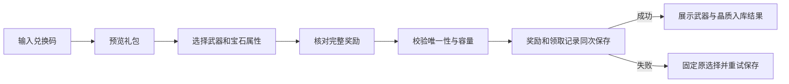

# 剑与火高阶兑换码方案

2026-11-17。兑换码以高级宝石、成长传奇武器为主，首批提供宝石自选和传奇武器四选一。入口放在「设置 → 旅途 → 兑换码」，沿用当前直接平台登录。礼包按本旅程限领，后续需要按账号限领或发放唯一码时再接入官方礼包服务。

以下四组兑换码已接入当前源码，入口、自选、领取回执、同次保存和宝石待领均已实现。实际运行与验证范围见文末记录；已有旧包不会自动包含本次功能。

## 首批高阶礼包

| 兑换码 | 礼包 | 具体奖励 | 建议用途 |
| --- | --- | --- | --- |
| `SFLEGEND` | 传奇启程 | 成长传奇武器四选一 ×1，加Ⅲ级宝石五属性自选 ×1 | 首批主打礼包 |
| `SFGEMS3` | 晶辉珍藏 | Ⅲ级宝石五属性自选 ×3，可分别选择属性 | 社区活动 |
| `SFGEMS4` | 星耀典藏 | Ⅳ级宝石五属性自选 ×2，可分别选择属性 | 版本福利 |
| `SFGEMS5` | 巅峰珍礼 | Ⅴ级宝石五属性自选 ×1 | 纪念活动 |

每个礼包使用独立、稳定的活动 ID，每旅程各领一次。四包全部领取，合计成长传奇武器 1 件、Ⅲ级标准宝石 4 颗、Ⅳ级 2 颗、Ⅴ级 1 颗。宝石按现有晶质库保存，对应Ⅲ级 20 份、Ⅳ级 10 份、Ⅴ级 5 份，选择相同属性时合并入库。

推荐优先完成「传奇启程」和「星耀典藏」两条完整流程，覆盖用户需要的传奇武器与高级宝石；其余礼包复用相同选择和发奖能力。首版交付必须包含这两类高阶奖励的合法来源、保存和恢复。

投放频次、活动期限和库存属于发布配置，不在方案中虚设日期或数量。固定本地码可随版本配置开放，实时上下架、限量和唯一码使用后述联网路线。

## 传奇武器四选一

优先复用现有四件成长传奇，玩家自行选择，默认高亮当前流派，不自动替玩家决定。

| 流派 | 物品 ID | 武器 | 原有特效摘要 |
| --- | --- | --- | --- |
| 战士 | `DG_L01` | 最后一班岗 · 单手剑 | 近战战技命中满足条件后，下一战技提供最大生命 8% 的短时护盾 |
| 弓手 | `DG_L02` | 逐月之弦 · 双手弓 | 实际移动 2 秒后，下一次弓术首次命中伤害提高 20% |
| 火法 | `DG_L03` | 长夜圣烛 · 双手火杖 | 火术命中燃烧目标，提前结算并增强部分剩余燃烧 |
| 雷法 | `DG_L04` | 雨前的静默 · 双手雷杖 | 雷术首次命中留下延迟雷印，另一次雷术可提前引爆并增强 |

四件均全等级可用、随角色等级成长、本旅程同名唯一。领取当前等级对应的原版武器，保留原有触发条件、冷却、成长、强化和镶嵌规则；不自动穿戴，也不附送强化或开孔。

选择页展示真实武器图、当前等级基础属性、完整特效和成长说明。玩家确认前可比较和改选；确认时将物品 ID 固定进领取记录。后续切职业、重试保存或重开都沿用原选择。

重复检查同时覆盖背包、`growing-owned` 唯一凭证和地面待拾取装备。已有的武器标明原因，允许改选其他未拥有武器。四件均已取得或待拾取时，将武器部分替换为「Ⅳ级宝石自选 ×2」，原礼包附带的Ⅲ级宝石仍保留；先展示完整补偿内容，再由玩家确认。宝石允许正常叠加。

领取装备使用独立的真实兑换来源，获得页显示「兑换礼包 · 传奇启程」。不制造首领击杀、剧情完成或自然掉落记录；原探索和首领奖励继续按已有规则结算。领取不会推进或重置首领抽取保底，也不会提前开放未发布章节。

后续若增加章节传奇，可复用「断岳之誓」四流派款 `LC2_T_L_*`（Lv16）或「山桥破阵」四流派款 `LC2_B_L_*`（Lv18），保留其真实装备等级。首批选择成长传奇，适合不同角色等级的玩家。

依据：[成长传奇定义及成长计算](../../src/cocos/assets/scripts/features/equipment/data/GrowingEquipment.ts)、[唯一性及来源校验](../../src/cocos/assets/scripts/features/equipment/common/GrowingEquipmentLoot.ts)、[章节传奇定义](../../src/cocos/assets/scripts/features/equipment/data/EquipmentLifecycle.ts)、[首领掉落与保底](../../src/cocos/assets/scripts/features/equipment/common/BossLoot.ts)。

## 高级宝石自选

现有宝石共五种属性：伤害加成、生命上限、护甲、暴击率、暴击伤害。自选页逐颗选择，允许同属性重复；不额外创造抽奖券、随机宝箱或新的宝石货币。

| 宝石级别 | 一颗标准宝石入库量 | 镶嵌条件 | 可否提前领取 |
| --- | --- | --- | --- |
| Ⅲ级 | 同属性Ⅲ级晶质 5 份 | 角色 Lv20 | 可以，先存入晶质库 |
| Ⅳ级 | 同属性Ⅳ级晶质 5 份 | 角色 Lv40 | 可以，先存入晶质库 |
| Ⅴ级 | 同属性Ⅴ级晶质 5 份 | 角色 Lv80 | 可以，先存入晶质库 |

宝石级别与装备品质分别计算。传奇装备最多 4 孔、神器最多 5 孔，符合品质的装备已有首孔；新增孔继续使用原开孔规则。单手武器每孔消耗 4 份晶质，副手 1 份，其余装备 5 份，属性按份数缩放。界面写清「标准宝石 ×1，折合晶质 5 份」，避免把 5 份显示成 5 颗。

下表为现有一颗标准宝石的基础计算值，奖励直接复用这些数值：

| 属性 | Ⅲ级 | Ⅳ级 | Ⅴ级 |
| --- | ---: | ---: | ---: |
| 伤害加成 | +0.45% | +0.675% | +1.0125% |
| 生命上限 | +4.5 | +6.75 | +10.125 |
| 护甲 | +0.225% | +0.3375% | +0.50625% |
| 暴击率 | +0.1125% | +0.16875% | +0.253125% |
| 暴击伤害 | +1.125% | +1.6875% | +2.53125% |

生命加成最终按角色总生命的现有规则取整；单手武器和副手按实际晶质份数折算。预览使用游戏公共计算，不能把标准颗数值写成所有部位的最终收益。

提前领取时显示「已入库 · Lv40可镶嵌」等真实状态。宝石库存页和兑换记录须能查看尚未达到使用等级的高阶库存，不能只列当前可镶嵌的级别而让已领宝石不可见。兑换不提高角色等级、不解除镶嵌限制。

依据：[宝石级别、属性、容量与计算](../../src/cocos/assets/scripts/features/gems/data/Gems.ts)、[镶嵌和合成规则](../../src/cocos/assets/scripts/features/gems/common/GemWorkshop.ts)、[现有宝石界面](../../src/cocos/assets/scripts/features/gems/runtime/GemPanel.ts)。

## 选择与领取流程

在「设置 → 旅途」增加「兑换码」，打开紧凑暗金面板。设置页保持原比例、三个页签和内部滚动；兑换页复用 `GoldPanelShell`、`GoldPanelHeader`、`GoldMenuButton`、公共字体与品质色。

输入码后，先显示礼包及选择次数，再进入武器四选一或宝石五属性自选。传奇页能查看未选武器详情；多颗宝石显示每颗当前选择和剩余次数。没有选满或重复提交时禁用领取。取消、返回和键盘确认均不消耗资格。

确认页同时列出武器、宝石属性、级别、标准颗数及晶质份数。若全部传奇重复而进入补偿页，明确区分「武器补偿」与原包宝石，并合并显示最终入库数量。来源、最终选择和奖励版本只在提交时固定；确认前状态变化则重新计算并让玩家重新确认。

输入优先复用 Cocos `EditBox` 并核对官方小游戏适配；粘贴通过平台适配接入，不依赖浏览器 DOM。按 844×390 逻辑视口设计，独立触区至少 48×48、相邻间距至少 8 逻辑像素。Header 依实际安全区和 TapTap 胶囊选择返回位置，返回原「旅途」设置页。

键盘弹出时保持输入和主要动作可访问；关闭、切后台、重建页面时清理键盘监听与隐藏热区。菜单期间沿用既有暂停规则，关闭后恢复原界面和操作。已领取记录可查看最终选择、补偿和待领余量。

| 状态 | 处理 |
| --- | --- |
| 码未识别 | 提示检查输入，保留已输入内容 |
| 已领过同一活动 | 展示原领取记录，不再发奖 |
| 目标传奇已拥有或在地面 | 标记原因，重新选择；全有时展示高阶宝石补偿 |
| 宝石未到使用等级 | 允许入库，显示具体镶嵌等级 |
| 晶质库有溢出 | 容纳部分入库，余量进入有来源的宝石待领记录，展示两部分数量 |
| 领取记录或宝石账本达到上限 | 提交前明确提示，保留资格，不发半包 |
| 存档需要恢复 | 使用已有恢复入口，暂不提交领取 |
| 保存失败 | 保留原领取结果和选择，只重试保存 |
| 成功 | 显示实际获得物品、入库晶质及待领余量 |

布局、外观和状态反馈遵循[项目 UI 技能](../../.agents/skills/singularity-ui-design/SKILL.md)。

## 高阶奖励的完整接入

实现复用现有武器和宝石内容，并增加真实兑换来源和可重放入账。以下记录当前接入契约。

### 活动和选择记录

每个礼包使用稳定 `campaignId` 和不可变的奖励版本，多个别名码共享次数。码统一为不超过 13 位的英文字母和数字，去掉首尾空格并转大写。已发布的活动定义和奖励版本保留，普通版本更新不重置资格。

领取记录结构化保存活动、奖励版本、稳定 `grantId`、会话序号、武器选择、宝石属性及份数、补偿原因和实际发放明细。`receipts` 可保留短索引，完整选择不塞进当前长度受限的单条字符串。配置白名单只包含首批四件传奇和五属性Ⅲ～Ⅴ级晶质。

确认凭证绑定当前旅程会话、状态版本、活动版本和全部选择。确认时再检查装备唯一性及容量，变化后重新确认，不静默替换武器或宝石。固定选择后重试沿用原 `grantId`，切职业不会重新生成奖励。

### 传奇的真实来源

会话统一编排装备入库、`provenance`、`grant` 回执和 `growing-owned` 唯一凭证，明确返回发放结果。当前私有 `grant` 遇到重复会直接返回，不能把「已经调用」视为「已经发到」。

新增如 `redeem:<campaignId>:<grantId>` 的来源验证，核对活动、最终选择、奖励版本和库存。成长装备优先进入 `validGrowingSource`，因此须同步扩展 `GrowingEquipmentLoot` 的来源分支；只给普通装备来源加白名单不足以支持这四件传奇。

首次获得沿用现有装备确认和展示，保持基础属性与原有成长效果。真实来源文案按领取记录显示，不修改所有同名自然掉落的来源说明。

### 宝石的入账和重放

当前 `GemGrant` 只能发任务或首领来源的碎片、开孔材料；现有宝石校验会从零重放余额，不能直接给 `gems.bank` 或 `gems.pending` 加数。

扩展宝石事务，新增由真实领取记录支持的兑换入账事件，将五属性、级别、份数和 `grantId` 固定下来。同步修改应用逻辑、字段白名单、序号、回执签名、版本及重放。兑换事件与镶嵌、合成、拆卸按序执行，核对多次领取与消费交错时的每笔入库、消耗和返还；合成按现有的15份低级晶质转换为5份高级晶质并扣费。

入库事件允许高于当前镶嵌上限的晶质，镶嵌及合成继续执行各自原规则。晶质库单键容量为 999999，溢出按确定规则进入现有 `gems.pending.bank`；宝石账本重放必须同时重现入库与待领数量。

待领的领取算法可复用现有实现，但来源必须由兑换事件支持。界面将仅描述培养返还的文案扩为「宝石待领」，并能从兑换记录查看及分次领取；不得把余量放进当前必须为空的顶层 `state.pending`。

为展示各礼包当前待领余量，账本同时记录每个来源的晶质待领份数，兑换来源绑定 `grantId`，培养返还绑定原事务。统一领取时按来源事件序号先进先出分摊，逐项扣减来源余量和全局待领余额，并在同一快照保存。重放核对各来源合计，防止把礼包初始溢出量误显示为领取后的剩余量。

### 单次保存和兼容

在可丢弃快照上校验整包变更，通过后将领取记录、武器唯一凭证、宝石事务和溢出余额作为同一个主存档快照提交。`SaveStore.write` 写后校验成功才提示领取成功。失败时保留带回执的当前会话并只重试保存，处理前阻止切换或新建旅程。

新增结构化兑换字段或宝石规则版本时，先用原格式校验当前 80 级规则旧档，再在副本上补空领取记录、转换宝石账本并重校验。保留已有装备、晶质、孔位、培养、掉落来源与交易历史，不迁移旧 40 级成长数据。

本地方案承诺每旅程一次。新建旅程、清除数据、回滚旧档或换设备不能保证账号限领；高阶奖励仍可按此规则提供，不擅自恢复自建登录。`dev` 继续由公共存储前缀隔离，`test` 与 `release` 共用正常旅程领取记录。

依据：[装备授予编排](../../src/cocos/assets/scripts/core/GameSession.ts)、[主存档校验](../../src/cocos/assets/scripts/features/persistence/common/CombatPersistence.ts)、[宝石账本与待领](../../src/cocos/assets/scripts/features/gems/common/GemWorkshop.ts)、[本地双槽保存](../../src/cocos/assets/scripts/features/persistence/common/SaveStore.ts)、[平台隔离](../development/platform-adapters.md)。

## 后续联网运营

需要账号限领、限量唯一码、实时撤码或定向补偿时，优先复用 TapTap 官方的码生成、有效期、上下架及核销服务；游戏方仍负责真实奖励入账。当前小游戏的游戏服务权限、Client ID、应用关联与请求域名须在真实后台核对。[官方礼包功能](https://developer.taptap.cn/docs/sdk/tds-gift/features/)

官方提供无服务器兑换 `submit-simple` 及游戏方服务端发奖模式 `submit-send`、`submit-check`。无服务器仍需要联网，测试与正式环境需分别配置应用；服务端模式的 Server Secret 留在服务器。[无服务器指南](https://developer.taptap.cn/docs/sdk/tds-gift/no-server-guide/)、[接入指南](https://developer.taptap.cn/docs/sdk/tds-gift/guide/)

当前平台登录只确认就绪，没有可直接用于账号礼包的业务身份；此前停用的 [taptap-auth](../../services/taptap-auth/README.md) 仅作历史参考。后续账号礼包可单独接入兑换身份流程，不改变普通游戏直接平台登录的方向。小游戏身份换取遵循一次性 code 到服务端 `code2Session` 的官方流程。[小游戏登录流程](https://developer.taptap.cn/minigameapidoc/dev/tutorial/open-capabilities/login-management/)

联网发奖按应用、环境、账号、活动去重，稳定 `grantId` 支持查询、重试和补领。平台已核销与游戏已保存分开记录；跨设备和存档回滚后的资产一致性需账号云档或服务端资产账本支持。平台与 HTML 的网络差异集中在 `platform/`，兑换失败只影响兑换页。[小游戏请求接口](https://developer.taptap.cn/minigameapidoc/dev/api/network/request/tap.request/)

## 实施与验收

功能归属采用 `features/redemption/{common,data,runtime,locales}`；会话提供单一领取入口，宝石和装备继续通过各自规则接入，存档验证集中在持久化层。

按以下顺序完成首版：

1. 固定四组礼包配置、四件传奇候选、宝石标准份数、选择和重复补偿规则。
2. 完成真实兑换来源、结构化领取记录、宝石事务重放、旧同规则存档兼容及单次保存。
3. 接入输入、武器比较、逐颗宝石自选、完整确认、获得展示、未开放级别库存和待领页。
4. 复用现有类型及规则检查，在真实 HTML 场景验证下表，不额外默认增加测试框架。
5. 在 TapTap Android 真机验证输入、触控、前后台及存读档；按 iPhone 横屏基准与更大视口检查安全区和布局，平台证据单独登记。

| 验收项 | 通过条件 |
| --- | --- |
| 四件传奇逐一选择 | 领取、保存、重开、穿戴、升级成长和原特效均正常，来源真实 |
| 高阶宝石提前领取 | Ⅳ／Ⅴ级库存可见，Lv40／80前不能镶嵌，达标后正常使用 |
| 数量与切割 | 标准颗为5份，4／1／5份镶嵌与拆卸数量守恒；合成严格按15份低级→5份高级转换并正确扣费 |
| 重复及补偿 | 背包已有、地面待拾、四件全有均正确处理，补偿不吞原包宝石 |
| 保存与去重 | 重复点、别名码、保存失败、后台和重开不重复发奖，原选择不变 |
| 容量与账本 | 满库溢出可追踪、可分次领取，记录上限提前拦截，多次领取与消费交错仍可重放 |
| 兼容与档位 | 原80级规则资产不丢失，dev隔离，正常test／release领取记录连续 |

四组码已启用，变更已登记到 `release/changes.json`。核心规则探针已覆盖四包数量、四件传奇的来源与恢复、全持有和地面待拾取的补偿、等级门槛、晶质切割、旧档兼容及混合来源待领顺序。实现没有新增自建登录、账号云档或联网核销，也没有制作或上传TapTap包。

正常test网页已重建，并从日常 `concept-2d` 输出制作固定验收快照。真实浏览器触控验证覆盖四码输入、逐颗自选、滚动选择、完整确认、保存失败门禁与重试、35份晶质总量、刷新恢复、重复码拦截、实际新建旅程备份与次数重置，以及844／932手机横屏和1280桌面界面。验证记录见[汇总](../../src/cocos/test-results/redemption-codes-v1/validation.json)、[合法装备与等级门槛探针](../../src/cocos/test-results/redemption-codes-v1/child-core-probe.json)、[宝石账本与FIFO](../../src/cocos/test-results/redemption-codes-v1/gem-ledger-review.json)。

完整TypeScript和核心类型检查通过。现有全量测试171项中167通过，4项自动剧情游玩出现行走超时或战斗死亡；复跑与边界记录见[失败调查](../../src/cocos/test-results/redemption-codes-v1/playthrough-review.json)，没有用修改地图或放宽测试来掩盖失败。TapTap真实宿主的原生键盘、平台胶囊、安全区及真机验收尚未完成，HTML通过不替代平台结论。
