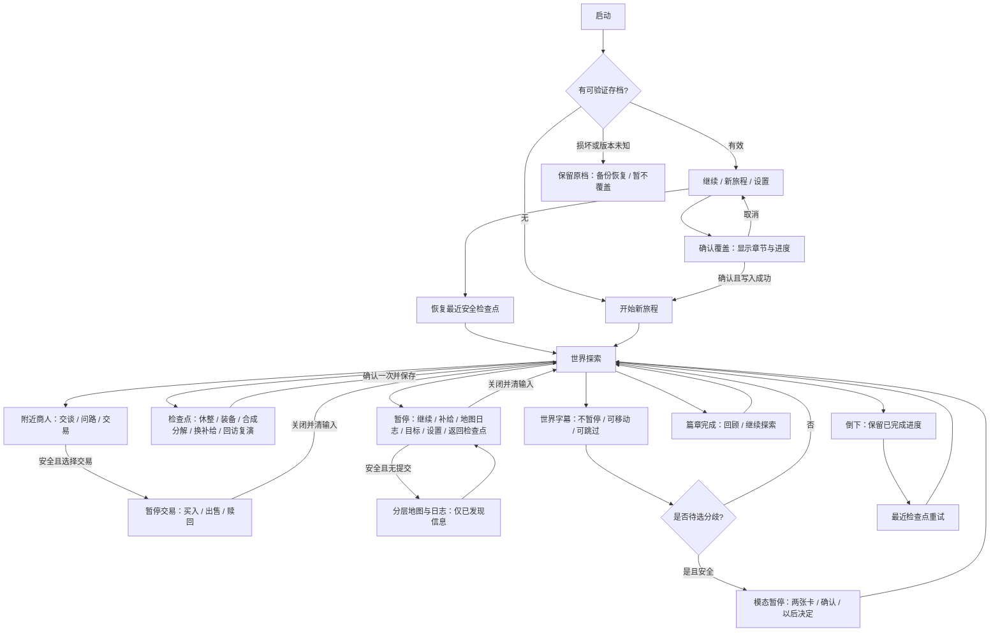

# 界面、输入、短教程与可读性

> **2026-11-02 09:42范围纠正：区域尺度v2再次被用户否决，尚未采用。** 本页关于每章12子区/4宏路径、520—600米包围盒、20—40分钟整章、212候选母项与新增铁40的段落只保留为被否决提案追溯，不代表v3范围或已启用奖励。新方向是剧情、人物任务、战斗与探索共同驱动的大型地上/地下区域网络；世界愿景不受首个制作样板大小限制。现有装备、一次性符、商人交易和旧ID保护规则继续保留；v3地图/剧情合同待真实参考研究后另定。

> **设计可评审；未实现、未做可用性/设备测试。** Android横屏为当前默认假设，未确认最低机型、屏幕尺寸、Tap环境能力。下列布局不是现有UI截图。

## 1. 输入与右手负担

桌面与触屏应具有相同能力。主攻击随主手显示“挥击/射箭/杖弹”；符咒构筑把两个消耗类型放入快捷栏，按库存安排连携；成功发出扣1张，耗尽回零消耗主手保底，不是装备两枚符就无限施放。当前设计有**7个战斗动作位**，不是旧版4键不变的承诺。换装备、配装、制造与分解只放安全检查点，不以战中换装刷新动作或冷却。

| 操作 | 桌面拟映射 | 触屏拟映射 | 连按/取消 |
|---|---|---|---|
| 移动 | WASD/方向键 | 左拇指可固定/浮动摇杆，半径44逻辑像素 | 死区0.15、>0.95满速；松手/取消立即归零 |
| 主攻击 | 左键/J；近战/杖按住可重复，弓按住瞄准/蓄力、松手射 | 最大按钮显示当前主手图标和“挥击/箭/杖” | 近战/杖单格缓冲；弓点射18/0.70s，按住0.8s蓄力30/总1.10s，最远9m，不按住自动连射；取消区/系统取消不射，基础弹不扣库存 |
| 武器技 | R | 主攻击左上“武器技”，显示当前招式名/专注或冷却 | 指向/落地技按住预瞄、合法松手确认；W15盾覆盖主手R为按住格挡、10专注/s；其余成本按装备表，无足够专注只提示 |
| 符咒一 / 二 | Q / E | 两个符咒快捷按钮，显示类型/形状/当前张数及按T保存的冷却 | 按住预瞄、松手施放；0.25s前摇/0.20s后摇，实际发出扣1+该T的CD，未发取消/打断不扣；0张/空栏禁用，受击打断有0.4s重试间隔 |
| 推 | L | 固定工具位“推”，掌/盾波图形 | 按下触发一次，按住不重复；任何武器仍能推 |
| 火油 | K按住预瞄，松开投 | 固定工具位“油”，按下瞄准、拖落点、合法区松手投 | 拖入取消区/右键或Esc取消；pointercancel不投；短点也先预瞄再松手 |
| 短闪避 | 空格 | 固定“闪”，脚步箭图形 | 按下沿一次；有移动沿移动方向，无移动后退；不冲向锁定敌 |
| 互动 | F | 情境手形“动词+物体”，战斗簇上方 | 一次提交一件事，不通过按住连领；E已用于符咒二，不能同时互动 |
| 地图与日志 | M，等同安全地图入口 | 暂停页“地图”按钮 | 3m无敌/无弹体且无交易/奖励/机关提交才展开；战斗中仅短提示，不吞移动/闪避 |
| 暂停/帮助 | Esc | 右上双竖线按钮 | 先取消预瞄，再暂停；退出面板先清输入，点继续恢复 |
| 选择/返回 | 鼠标/方向键+Enter，Esc返回 | 卡片点选→确认，返回箭头 | 确认连点只一次，返回不保存未确认选择 |

不用未定义的慢时轮盘来隐藏按键成本。推/油为固定、可直接触达的工具快捷位，不因装备弓杖消失；首章未解锁油壶时油位显示锁与说明。动作簇分主攻击/闪避、武器技/双符咒、推/油三组，最常用主攻击最大，不要求右拇指同时按两个技能。战斗键目标≥52逻辑像素、主攻击≥68、间距≥8，系统安全区外额外留12。提供整体80–130%缩放、位置微调、左右镜像和恢复默认，不允许重叠覆盖摇杆/暂停/互动；最小屏不能容纳时必须重排并验证，不缩成难点的小图标。

### 横屏草图 未实现

```text
┌────────────────────────── 安全区 ──────────────────────────┐
│ 生命  专注当前/上限  油3/3       当前目标                 [暂停]  │
│ 已保存 ✓ / 尚未保存 !     敌方状态仅显示主要图标             │
│                       2.5D世界 / 地面预警                  │
│                   目标脚圈       [手形：动词]               │
│                                    [符一3张] [符二3张]           │
│   (摇杆)                     [武器技]     [闪]              │
│                               [ 主攻击 ] [推] [油]         │
└────────────────────────────────────────────────────────────┘
```

布局仅为纸面候选，须以双拇指遮挡和最小屏测试决定最终排布。右手单指能完成指向技预瞄，左手仍能移动；左指抬起不误投，右指抬起不保持移动。触点归属由起点控件锁定，跨到另一个按钮不触发它。第三指只可点暂停，不抢移动/预瞄；系统边缘手势必须释放相关输入。同一时刻只允许一个主动动作或一份预瞄，切到另一技能先取消原预瞄，不残留第二个确认。

## 2. 战斗与交互目标优先级

判定严格按：**过滤资格 → 评分 → 稳定锁定 → 接收动作时锁快照 → 有效窗再验证**。不在攻击期间自动从死者跨屏跳到另一个人。

### 战斗

1. 排除已败/投降、不可见但隔墙、不可达高台、超出当前招式合法射程的对象；单手剑基线1.45m，弓/杖/指向技以装备招式表为准，不保留旧统一6m筛选而截掉弓箭射程。屏幕投影重合不代表地面距离近。
2. 玩家明确点选/鼠标指向的合法目标优先；触屏无明确指定则按最近有效攻击距离、前方夹角、正在威胁玩家排序。最小距离差<0.25m时保留原目标，防止两人间脚圈闪跳。
3. 目标脚下实线圈+短朝向缺口；可按点另一名敌人切换。当前目标离合法区>0.4s才释放；无目标则沿最近移动朝向挥空，而不是自动转180°砍桶。
4. 近战辅助转向最大45°；推最大25°；弓/杖/指向技以装备招式标记及真实射线为准，不能穿墙吸附；前摇最后0.05s锁朝向，后来的目标移动可让攻击挥空。鼠标/手动指向可以超过辅助角，但仍遵循前摇锁定。
5. 敌人优先于油桶，油桶优先于普通箱，NPC/关键货物永不战斗锁定。**只有手动点桶或火瞄准真实落点**才把桶当主目标；近战弧/合法弹体真实扫到侧边桶时按该招式的点燃标签处理，视觉预警不能省。
6. 不因自动瞄准向前走；超距只灰虚线圈/“靠近”，不会代跑到火里。箭线/杖弹射线、技能落区和火油落点必须显示真实阻挡与不可燃区；普通箭或非点燃杖弹不会仅因命中桶就造出火。

### 非战斗

同一手形范围内按“当前任务可完成机关 → 当前任务NPC → 关键证据/唯一奖励 → 检查点 → 普通箱/装饰”排序；同优先级取接触点距离，差<0.20m保留原对象。玩家点具体对象可覆盖自动优先至离开范围；长按手形0.35s可显示最多3个近邻对象标签供点选，不新增轮盘层。

敌人进入3m威胁区时，不弹对话/改装页；水槽这类战斗机关例外，只播短动作不弹菜单。物体被墙/另一层隔开时可显示名字/方向，但手形禁用并解释“绕到另一侧”。

## 3. 遮挡、镜头与非颜色提示

2.5D固定俯斜角，不默认让玩家手动旋转。角色被前景屋顶/大树遮住时仅把遮挡前景淡化并保留角色轮廓；不能把墙淡化理解为能穿墙。敌人预警贴真实地面，桥上下层用不同边框/虚线高度标，不让投影重合产生假命中。

- 主线：手形+短动词；证据：纸页；关键遗物：盾形圣匣；普通可燃杂物：火苗划痕；油桶：油滴；已完成：勾与灰纹。每项颜色之外均有图形/文字。
- 开“减少动态”：镜头震动0、减少火花/屏闪、关闭击杀推镜头；仍保留预警边框、倒计时轮廓与受伤音。受伤不必全屏染红。
- 开高对比：地面危险区域加斜线和≥2逻辑像素外轮廓；关键交互文本加不透明底。可调文字100/125/150%，长中文目标两行内，超出折叠详情而非缩成蚂蚁字。
- 音频分主音量/战斗/环境；字幕始终可用，可关闭声音独立通关。震动可全关；不假设目标设备支持震动。
- 头目双段攻击每段都有形状变化+动作；不能把红变橙作为唯一第二段信号。冷却用遮罩扇面+可选秒数，空油用空壶，不只灰化。

## 4. 可跳过的短教程

教程不是“必须按指定按钮才能开门”的教学锁。玩家已自然完成动作即记完成，不再强迫重演。各提示≤两句，首次最多停留5s，设置中可重看；战斗中不出现需关闭的长面板。

| 时机/拟ID | 一句提示 | 自然验证/跳过 |
|---|---|---|
| 营地 `design_tutorial_move` | “左侧移动；走近艾妲领取委托。” | 移动2m/与艾妲交互即结束；也可直接走出安全教学范围 |
| 木桩 `design_tutorial_sword` | “挥剑可击中前方一片敌人。” | 任意有效剑一次；跳过不影响获得剑 |
| 圣匣车 `design_tutorial_push` | “推开灰披佣兵，给自己留条路。” | 推中敌/箱一次；只靠剑清敌也继续 |
| 油壶 `design_tutorial_fire` | “按住火看落点，松手投出；拖到取消区可收回。” | 安全桶旁演示可选；无需消耗任务赠油，不锁下个目标 |
| 近路改装 `design_tutorial_modifier` | “训练只选一项，装备和套装可共同生效；检查点换装。” | 首次打开卡片，可点以后再说 |
| 誓堂前院 `design_tutorial_water` | “开水槽能清货道火；罩布下的遗物有盾形封签，不会烧坏。” | 第一次开阀或跳过；图标常驻可查 |

世界短对白是非模态字幕，不暂停游戏、可边走边看；遇战斗字幕退到次要位置，不抢输入。文书详情页/有限选择卡才是模态，只在安全状态打开并暂停游戏，关闭时清输入后继续。剧情跳过仅跳对白表现。遇有限选择必须独立弹选择卡；“以后决定”回世界，交章时用明确默认提示再确认，不能悄悄替玩家选择。文本不以惩罚警告逼玩家看完。

## 5. 页面流（草案）



选择/兑换/新游戏的确认按钮执行时先禁用，成功/失败后给单一结果；关页不触发第二次执行。桌面Enter不能穿透确认层触发底下世界互动。返回键先关闭最高层面板，再暂停，不直接退出游戏丢进度。

## 6. 设置与异常文案

| 状况 | 提示/可行动项 |
|---|---|
| 存储成功 | “已保存 · 木门前”，短显示后变勾 |
| 配额满/不可写 | “本次进度尚未保存。可以继续；离开可能丢失。重试保存 / 保留当前游玩”——不能自动清旧档 |
| 损坏存档 | “这份存档未能读取，原文件已保留。尝试上次有效记录 / 返回”——没有证据时不称已修复 |
| 后台恢复 | 暂停遮罩“已暂停，点继续”；所有指针归零；不自动投火 |
| 设备旋转/窗口变化 | 暂停并重新布置安全区，保留有效进度；若目标平台暂不支持旋转，提示横屏，不裁掉按钮继续战斗 |
| 交互被挡 | “站到把手一侧”+脚印，不弹模糊失败窗 |
| 尚未制作后续章 | “《灰披宝匣》内容到此；可继续探索。后续章节仍在设计。”不出现无响应的进入按钮 |

这些文案与布局需纸面评审、真机拇指覆盖/最小屏幕验证后才能标为可用。当前不报告任何测试通过。

## 7. 宝物选择与装备展示

第三章模态卡标题为“取走完整护符，还是拆出铜芯”。这件共享装配古物不是鹿角圣印；拆护符不会毁掉主线线索。两卡用图标+完整效果+不可逆取舍：

| 卡片 | 选择前必须看见的说明 |
|---|---|
| 保留守誓护符 `keep_oath_charm` | 选为训练时生命上限+15，闪避冷却+0.10s；不立即回血。保留完整件，将失去余烬铜芯；下一章布1。 |
| 拆取余烬铜芯 `take_ember_core` | 选为训练时火油火区4→5s、半径1.1→0.95m，伤害不变；完整护符不可恢复。下一章油1。 |

卡下写“只能取一件，解锁对应传承训练；确认后不能改选”。训练限选1项，但不关闭其他装备效果。默认仅高亮完整护符，不预先确认。拆解确认按钮明确“拆开护符并取铜芯”，返回可继续探索。两张卡都是打法取舍，不标善恶/推荐真结局。旧版送货或保管选择不转成拆解授权；已有旧补给时写“旧补给已保留，本次只领取所选装备”。

传承训练目录9种、单档最多8种，训练自身限选1项；与9永久槽的固有效果和套装并存；2符快捷只供使用消耗品，不给永久属性或套数，不再显示旧版全系统共享效果空槽。护符/铜芯互斥未选项标“已放弃”，不花钱解锁、也不从合成绕过选择。侧箱早得训练标“提前取得”，主线只补未有项。列表可滚动，当前训练与效果来源清晰；不能把多张卡缩在一屏牺牲字号/触点。

每次头目胜利区的固定宝匣提供一张短装备卡：名字、实际变化、取代/占用哪一槽、取得/稍后查看。显示战利品时先确保安全并暂停卡面；关卡不强迫立即穿戴。三处支箱用可区分的图标和属性卡，旧6张卡复用基础图形，新护符/铜芯/破阵扣各有专用图标；这9项训练不另加主动键，武器技/双符咒键已在第1节列明。

任务标题为灰披宝匣、沉桥宝库、沉钟秘藏、灰石堡宝库。最多一行线索串起“空托转运单→沉桥藏品拓印→沉钟宝匣与堡库清单→军械库主宝箱”，跳过全部对白仍知道下一处宝物在哪里。终章目标写“打开军械库栅门”和“取走主宝箱”，不再显示解放城门、分粮或保管承诺。

## 8. 永久装备 符咒快捷与制作面板

装备页展示9永久槽：主手、副手、头、身、手、靴、戒指×2、项链；另有1训练位。符咒在独立消耗品列表，2快捷栏只引用同一背包堆叠，不计套装、不增加永久属性；两栏禁止同T。永久戒指同ID不能重复装备。双手近战/弓/双手杖占主副手，盾只配单手近战、法器只配单手杖；比较面板明确W15盾覆盖主手R、W16只加专注上限不回满。预览按最终9槽+训练验证，取消还原全部方案，不改生命/专注/CD。

6套各5件永久候选，任意2/4件给奖励，4件同时保有2件效果；2+2可混搭，5件无新档。缄印套五件为W16/J04/A11/A15/J07，不含T02/T03，面板明确“符是消耗品，不用穿符凑套”。缄印2减符使用CD10%，4件由两个不同、已消耗符命中同敌触发原封印爆；绝不返符、免费复制或免扣。品质/等级/招式/真实变化分别显示，不画传奇全绿升级。

符咒卡须同时写“成功发出消耗1张”、当前/类型容量、总符容量和本T冷却。T01—T07各cap12，T08 cap1，合计cap48包含T08；0张按钮显示“已用尽 · 需制作/领取”，仍保留类型可查，不自动切到另一符。换快捷栏不搬数量、不刷新CD、不补符；快捷栏不是两个独立弹匣。已发出落空/免疫仍扣，前摇取消/受击打断不扣，确认消耗不以命中为条件。永久护符/项链与消耗符分栏，不共用“装备后反复用”的说明。

制作页分“永久装备”与“消耗符”：17张永久图纸中10张制造唯一永久物、7张按批制造符。C11/C12/C13/C14/C15/C16/C17分别用铁4/6/2/3/3/4/4产T05/T07/T01/T02/T03/T04/T06各3张，不耗符纹/芯；T08无配方、唯一1张。制造前显示完整批次产量、类型/总容量差额，不够容量整批拒绝且不扣料；固定领取满额则保待领余量。仅10种未装备合成永久物可分解，符咒不可分解，唯一探宝物不可拆；任何返还溢出先拒绝，不先毁物。

四流派首章卡分清：弓基础箭无限、箭式20专注/8s；杖基础弹无限、武器技耗专注；专注基础100、W16为120、5/s恢复（J04+1/s，总≤8/s）。符流初始T01共6张并学C13，原固定T02/T03包各3张且附C14/C15；商店买一张不附图纸，库存补充是循环成本，弹药耗尽用免费杖弹。每张说明可跳，不强迫消耗符、投油或花材料才能离开。

首章真实旅程可用C13制T01；隔离试装台另临时开放C01及虚拟材料走制造/分解，也可预置消耗符测试；入口标“测试配装，不改旅程”。退出丢弃虚拟成品、符数量、发现记录、配方、材料和收据，不向真实旅程提前发后章物品。

## 9. 回访与复演入口

检查点将“回访已探索区域”和“复演已战胜头目”分成两个按钮，不能把继续探索变成复活世界。首章只显示已解锁当前章检查点，未实现跨章路径不提供传送；跨章回访仅在实际路径和目标章完成制作后开放。回访不自动休整、不赠材料。

首章交接完成才出现灰披队长复演。进入卡明确“临时副本，不改剧情；真实消耗不变；胜利铁2”，模式写“普通”或“禁投火油”，后者同时禁免费投油，但允许合法场景桶及装备火系法术，因此不能标“全程无火”。用入场前真实9槽永久装备、2个已发现符类型快捷引用、1项训练和套装的快照，虚拟计数从0开始；副本内不显示合成/兑换/真实装备转移。

有奖复演不设日次数，但仅1份0—2铁待领；有余量时按钮改“无奖练习”，不能悄悄覆盖未领奖。复演只给所选已发现T01—T07各虚拟3张、T08已发现则1张（真实用完也可练），耗尽不场内补符；正常退出只恢复原真实血油、符数量、专注、主动技冷却与效果计数，冷启动按统一恢复规则，不把副本满血作为免费治疗。结算页明确只有废铁，不画未承诺的稀有武器掉落图。完整状态见[探索第5节](exploration-and-replay.md)。

## 10. 商人与分层地图

靠近已出现商人按F，提供交谈/问路/交易三个独立项，跳对白不丢交易或免费线索。1.35m同层无遮挡、3m无敌且无弹体/奖励提交威胁才可开交易；打开暂停。商店页首显示商人姓名/当前地点、金币当前/9999、唯一货售罄与下批条件。买入/出售/赎回三页分开，不默认全卖低品质；已装备/保护/制作物/所有符的出售项给具体禁用原因。

买永久物先看现有9槽/套装对比，默认收下不自动穿；买符按张选数量，显示单价、总价、商人余量、本人该T/总符容量，任一不足整笔拒绝。消耗符写“每成功发出扣1张”，买入不赠非该来源附带图纸。出售逐件确认，明确所得；赎回保同实例且付原售所得，不限时、不随补货清空。确认按钮先禁用，重复请求读同一结果；写失败持续“尚未保存”，只重试快照。完整货池与价格见[商人与交易](merchants-and-trade.md)。

地图/日志 `ui_region_map_journal` 是可关闭的四区域分层页面，不是常驻minimap。暂停页“地图”或M安全快捷入口打开；仅附近3m无敌/无弹体且无交易、奖励或机关提交时暂停展开，战斗中按M短提示而不弹模态/吞移动闪避；关闭清输入再恢复；图层由实际观察揭示雾区，已发现线索/商人/检查点才有形状+名字标记，不显示未发现藏宝答案。已迁移商人旧点显示已知去向，不假装旧点仍可交易；未发现目的地不代揭雾。听闻/远望地标、现场验证连接与已亲抵解锁检查点要分开标，点地图不等于开门/拿奖/传送。首章只列已制作当前章已发现点，不展示可进的后续空图；路网、图层和发现判定以[地图探索逻辑](../story/exploration-map-logic.md)为准。

## 11. 被否决区域v2显示提案留档

区域尺度v2仍使用同一 `ui_region_map_journal`，不新增战斗快捷键或常驻小地图。区域总览须看出12子区的实际间隔、4宏路径和主要地标；查看已知局部/切层不把设计者全知图当玩家已发现图。缩放/平移和局部名称的触屏热区须单独走查，不能把所有地牢入口、箱子和敌人密铺到一屏靠缩小字体解决；“未知/听闻/亲历”与“地面/内部层”仍分开。

地图显示的包围盒米数与主线20—40分钟、含探索35—60分钟均为灰盒前候选，不放“已验证可玩面积”或倒计时。原12检查点不随12子区/第4宏路径复制；点一个未解锁地标不允许传送。亲抵旧锚点不能瞬间揭开整个扩大的同名子区，入口相邻也不得跨层交易或开箱。新的室内入口/材料匣仍用F/手形交互，不新增付费钥匙、职业门槛或第五套地图输入。
