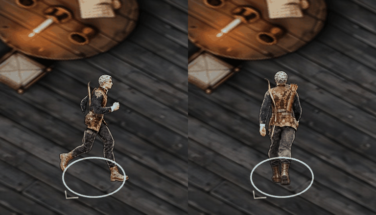

# 共用走跑身体与武器挂点 v3

后续用户复核发现的4个背跑小腿/脚踝扭曲帧及放箭镜头/箭身方向问题，已在[bow-alignment-v1](../bow-alignment-v1/README.md)继续修正；本页保留共用身体架构与当轮制作记录，当前腿形以该后续实机验收为准。

2026-11-09，已接入默认7469本地试玩。

按用户提出的复用方式，W01/W02/L01/W07/W08/L02/W11与收持/手持状态使用同一套身体。四向步行各4帧、跑步各8帧，共48帧、3张身体图集；34个旧动作别名映射同一身体，攻击与待机继续使用原来各自的姿势。装备图集复用56个已审阅武器视图，另含12个箭筒视图与48个手指/袖口遮挡。武器跟随逐帧手部挂点，箭筒跟随背部，前后遮挡按方向处理。

复用原W01大步走跑周期、已有准备/原地姿势、武器分离视图、姿势点、Pillow/SciPy及项目原生Cocos透明quad/SpriteFrame。没有引入新依赖或另一套动画引擎。头部通过上身配准与原点修正稳定，髋部以下保留步幅；衣服按已审阅待机参考校色。移动输入决定步态，实际位移决定移动朝向、静止及节奏，碰撞降速不再切成走路。换武器或收持切换不重置连续步伐。

## 来源与制作

- 身体：原运行清单的`explore_walk_W01`、`explore_run_W01`；身份与无武器衣料来自相邻`attack-identity-v5/masters/neutral-*.png`。
- 武器：`attack-identity-v5/edits/static-gear-validation/`中56张已审阅RGBA。
- 调色、打包、姿势与图像处理：复用`local-qwen21-unified-v3`和`attack-identity-v5`中的现有确定性工具；路径名中的Qwen为历史工具目录，本轮未运行本地生成模型。
- 云端OpenAI image_gen共1次，仅修复四帧背面步行小腿/脚踝/靴子。提示词见[back-walk.prompt.txt](back-walk.prompt.txt)，完整生成结果为`back-walk-cloud.png`，只采用标准画布y573以下的局部，身份与上身保护。生成成功与验收分别记录，未将整张生成图作为人物安装。
- 当前制作入口：[shared_locomotion.py](shared_locomotion.py)，候选合成检查：[shared_review.py](shared_review.py)。`repair.py`、`review.py`为已放弃的拼接试验，不是当前安装入口。

候选、原始SHA、生产图SHA与安装门槛见[制作记录](shared-prepare-report.json)、[美术审阅](shared-art-review.json)、[安装记录](shared-install-report.json)。原69张图集及元数据未删除。当前人物实际加载37张纹理，新增4张。

## 实机验证

沿用95项既有规则测试、核心与游戏源码类型检查通过，默认`npm run build`成功。实际运行的清单与源清单完全相同，4张新增PNG的编译字节SHA与源图一致。

[capture-runtime.cjs](capture-runtime.cjs)在独立浏览器测试档运行，未写入用户存档。816次动作/方向/阶段采样确认真实材质、帧索引、挂点、遮挡与缩放。S01-T1、S01、S02、H01、U1-04五个真实场景各覆盖120帧跑步、120帧慢走，无步态误选；其中16次全速输入的实际速度低于旧2.5阈值，仍为跑步。见[runtime/report.json](runtime/report.json)。

已逐图审阅实际Cocos截图的背面靴形、宽步幅、统一衣色、弓/箭筒与握持位置；[头部测量](shared-head-registration.json)的循环范围在400px/m标准画布上最大横6/纵5像素。原有`browser-motion.cjs`覆盖剑、弓、杖、施法、闪避与跑动，实际材质均匹配姿势。普通用户存档已通过界面刷新并实按D键确认大步跑动，等级40及无需蓄能状态保留。

本轮验证覆盖5个代表场景，未声称人工逐一游玩97个地点或完成真实手机性能验收。

